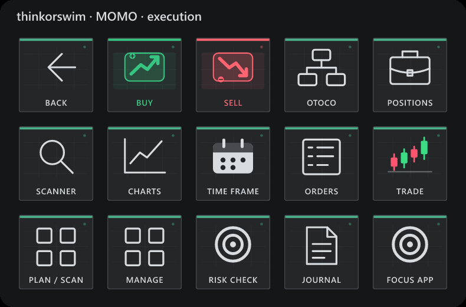
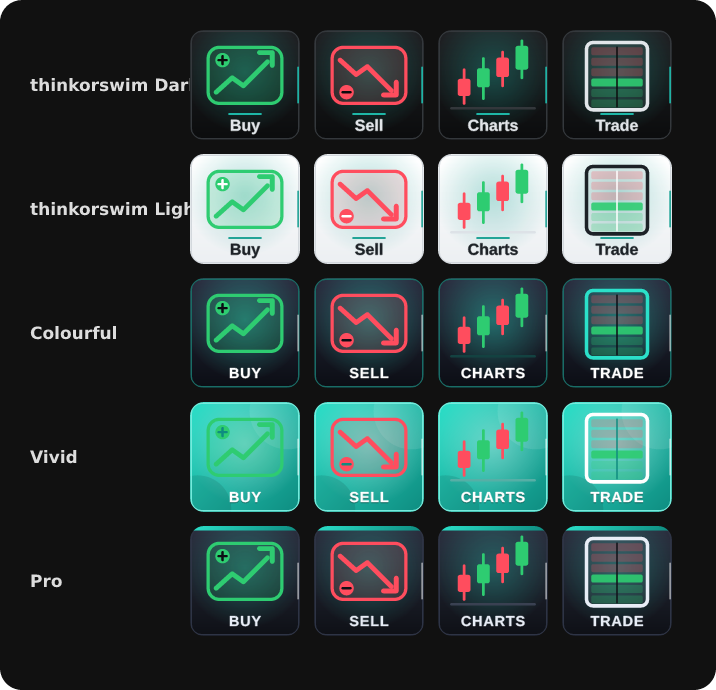
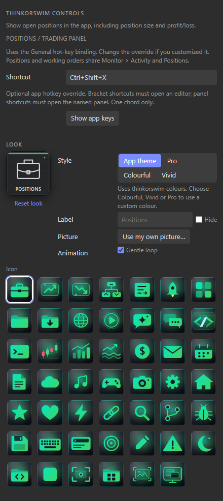

# thinkorswim Controls

Unofficial Windows companion for Elgato Stream Deck. Version 1.2.1.0.

Three editable pages organize preparation, execution and position management. Stocks only: no options workflow is bundled.

- Trade: Buy, Sell, editable OTOCO, Positions and Orders stay within one press.
- Plan: chart confirmation, watchlist, trade plan and risk check. Use linked Daily, 5-minute and 2-minute charts for context, confirmation and timing.
- Manage: partial exit, breakeven, trailing-stop, orders and journal. The partial-exit workflow is intended for a one-third reduction after a planned 1R move; the broker must supply any position-dependent calculation.

**Broker setup is required.** Buy/Sell send one explicitly configured broker hotkey using the app's symbol, account, quantity and order defaults. They do not calculate an order or append Enter. A press is never queued, retried, or repeated while held. The trading app must already be in front. Cancel orders and Flatten require a one-second hold; releasing early or leaving the page cancels that press.

Keys marked SETUP have no working default. Match a broker-supported hotkey in the inspector. Trim 1/3, Stop to B/E and Trail stop require corresponding broker capabilities; the plugin cannot infer fills, position size or stop prices. If unsupported, manage the order in Positions / Orders. Trade plan, Risk check and Journal accept your own full http(s) URLs. No personal service addresses are bundled.

thinkorswim supports direct Active Trader orders with Auto Send. Configure and verify the intended Buy/Sell behavior in paperMoney first. General Monitor, Scan and Charts shortcuts are provided and can be overridden; the Trade shortcut may be customized. This installation exposes no usable Java control tree for the bracket template picker, so OTOCO requires a supported editor-opening shortcut or manual selection of Active Trader > Template > TRG w/bracket. The plugin does not claim automatic template selection works on inaccessible Java controls.

The Custom shortcut and other non-trading keys send one shortcut and never Enter, so they cannot be used to bypass the trading safeguards. The input dispatcher and deck behavior are tested with isolated fixtures. No live orders were placed, changed or cancelled during validation.



## Install in three steps

1. Download **ThinkorswimControls-Installer-1.2.1.0.zip** from [Releases](https://github.com/nikhilgs817/streamdeck_thinkorswim/releases/latest).
2. Right-click the ZIP, choose **Extract All**, and open the extracted folder.
3. Double-click **Install-ThinkorswimControls.cmd**. Wait for the installation success message; Stream Deck restarts automatically.

No Git, Node.js or build commands are required. Windows Daily Toolkit is included for automatic app switching. The installer verifies files, backs up your setup, preserves existing layouts/settings and rolls back failed updates. [Full installation, update and recovery guide](docs/INSTALL.md).

## Use

Requires Windows 10/11 64-bit and Stream Deck 7.1+. Open or focus thinkorswim to show its keys automatically; **Back** returns to the main keys. Profiles also work when selected manually. Configure shortcuts and appearance by selecting a key in Stream Deck. Existing action IDs remain compatible.

## Appearance



**thinkorswim Dark** is the default: black trading-terminal keys, a teal accent, bold Segoe UI labels and an animated icon on every key (candles grow, the ladder lights level by level, the scanner sweeps, Level 2 bars breathe, the trail-stop dot moves along the price). The icon moves gently and an accent light travels round the key; labels stay still. **Buy is always green and Sell always red** in every style. thinkorswim Light, Colourful, Vivid and Pro use the same icons; Colourful, Vivid and Pro accept any colour. Decorative candles, bars and dots are animation only, never live market data.

## Build and verify

```sh
npm ci
npm run build
npx tsc --noEmit
npm test
npm run test:ui
npm run validate
npm run pack
npm run build:installer
npm run test:installer
```

Installer: `dist/com.dailyops.thinkorswim.v1.streamDeckPlugin`. Sources and dependencies are self-contained. Personal profiles, credentials, account data and build output are excluded from Git.



## References

- [Official app documentation 1](https://toslc.thinkorswim.com/center/howToTos/thinkManual/Getting-Started/Keyboard-Shortcuts)
- [Official app documentation 2](https://toslc.thinkorswim.com/center/howToTos/thinkManual/Trade/Active-Trader/AT-Entering-Orders)
- [Windows Daily Toolkit](https://github.com/nikhilgs817/windows_daily_toolkit)

## Trading risk

Trading involves risk of loss. This plugin only sends the keyboard shortcuts you configure; your broker settings decide what an order does (Auto Send places orders immediately). **Use at your own risk, test in paperMoney first, and keep the keys you use for orders where you won't press them by accident.** This is not financial advice and there is no warranty or liability (see LICENSE).

Not affiliated with or endorsed by Charles Schwab & Co., Inc. thinkorswim is a trademark of Charles Schwab & Co., Inc. The icons are original artwork. MIT license.

The build uses the official Rollup WASM package to avoid native parser dependencies on restricted Windows PCs.
