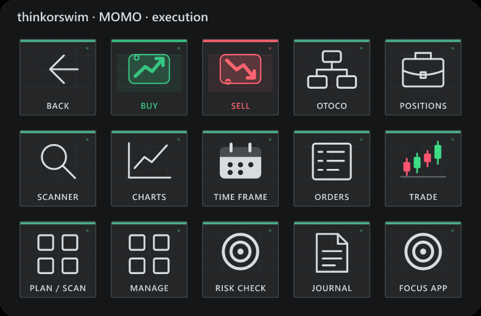
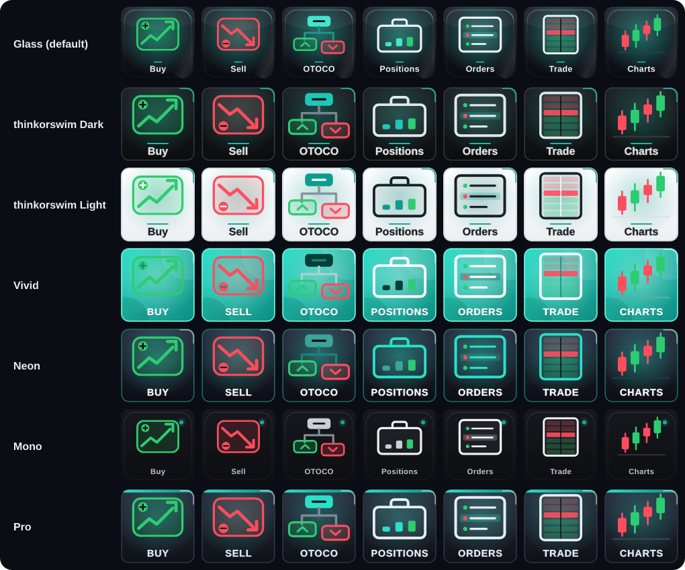
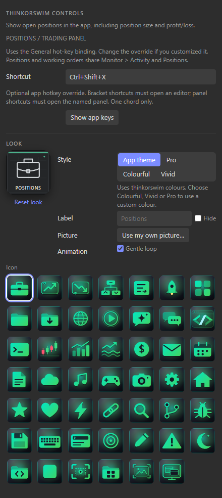

# thinkorswim Controls

Unofficial Windows companion for Elgato Stream Deck. Version 2.1.0.0.

Three editable pages organize preparation, execution and position management. Stocks only: no options workflow is bundled.

- Trade: Buy, Sell, editable OTOCO, Positions and Orders stay within one press.
- Plan: chart confirmation, watchlist, trade plan and risk check. Use linked Daily, 5-minute and 2-minute charts for context, confirmation and timing.
- Manage: partial exit, breakeven, trailing-stop, orders and journal. The partial-exit workflow is intended for a one-third reduction after a planned 1R move; the broker must supply any position-dependent calculation.

**Broker setup is required.** Buy/Sell send one explicitly configured broker hotkey using the app's symbol, account, quantity and order defaults. They do not calculate an order or append Enter. A press is never queued, retried, or repeated while held. The trading app must already be in front. Cancel orders and Flatten require a one-second hold; releasing early or leaving the page cancels that press.

Keys marked SETUP have no working default. Match a broker-supported hotkey in the inspector. Trim 1/3, Stop to B/E and Trail stop require corresponding broker capabilities; the plugin cannot infer fills, position size or stop prices. If unsupported, manage the order in Positions / Orders. Trade plan, Risk check and Journal accept your own full http(s) URLs. No personal service addresses are bundled.

thinkorswim supports direct Active Trader orders with Auto Send. Configure and verify the intended Buy/Sell behavior in paperMoney first. General Monitor, Scan and Charts shortcuts are provided and can be overridden; the Trade shortcut may be customized. This installation exposes no usable Java control tree for the bracket template picker, so OTOCO requires a supported editor-opening shortcut or manual selection of Active Trader > Template > TRG w/bracket. The plugin does not claim automatic template selection works on inaccessible Java controls.

The Custom shortcut and other non-trading keys send one shortcut and never Enter, so they cannot be used to bypass the trading safeguards. The input dispatcher and deck behavior are tested with isolated fixtures. No live orders were placed, changed or cancelled during validation.



## Install in three steps

1. Download **ThinkorswimControls-Installer-2.1.0.0.zip** from [Releases](https://github.com/nikhilgs817/streamdeck_thinkorswim/releases/latest).
2. Right-click the ZIP, choose **Extract All**, and open the extracted folder.
3. Double-click **Install-ThinkorswimControls.cmd**. Wait for the installation success message; Stream Deck restarts automatically.

No Git, Node.js or build commands are required. Windows Toolkit is included for automatic app switching. The installer verifies files, backs up your setup, preserves existing layouts/settings and rolls back failed updates. [Full installation, update and recovery guide](docs/INSTALL.md).

## New in 2.1: Design System 4

| What | Details |
|---|---|
| **Glass is the new default** | Frosted dark keys, a soft rim light and Title Case labels. thinkorswim Dark, thinkorswim Light, Vivid, Neon (formerly Colourful) and Pro are still here, plus the new **Mono** look. |
| **Custom colours** | Pick any two colours for a key instead of a theme. |
| **Motion styles** | Full, Glow only, Icon only or Still, at Slow, Calm, Normal or Fast. |
| **Glow and ripple** | Subtle, Normal or Bold glow, and a short ripple when you press a key (can be turned off per key). |
| **Labels** | Up to 18 letters, fitted to the key, in Auto, Title Case or UPPER CASE. |
| **Whole deck at once** | **Use this look on all keys** restyles every key of the plugin. |
| **Respects Windows** | Keys stop moving when Windows **Animation effects** is off (you can opt out). |

The design is shared with [Windows Toolkit](https://github.com/nikhilgs817/windows_toolkit) 3.1, so all your plugins can look the same.

## Use

Requires Windows 10/11 64-bit and Stream Deck 7.1+. Open or focus thinkorswim to show its keys automatically; **Back** returns to the main keys. Profiles also work when selected manually. Configure shortcuts and appearance by selecting a key in Stream Deck. Existing action IDs remain compatible.

## The keys

| Page | Keys (left to right, top to bottom) |
|---|---|
| **MOMO · execution** | Back, Buy, Sell, OTOCO, Positions, Scanner, Charts, Time frame, Orders, Trade, Plan / Scan page, Manage page, Risk check, Journal, Focus app |
| **PLAN · daily / 5m / 2m** | Trade page, Scanner, Charts, Time frame, Chart settings, Trade plan, Risk check, Watchlist, Level 2, Time & Sales, Manage page, Hot-key setup, Zoom in, Zoom out, Focus app |
| **MANAGE · protect / reduce** | Trade page, Positions, Orders, OTOCO, Trade, Trim 1/3, Stop to B/E, Trail stop, Journal, Risk check, Plan / Scan page, Cancel orders, Flatten, Focus app |

Also in the action list: Copy, Paste, Undo, Redo, Next field, Previous field, Dismiss, Page up, Page down, Custom shortcut.

| Key | What it does | How |
|---|---|---|
| Back | Return to the main Stream Deck keys. | Returns to your main keys |
| Buy | Send your configured immediate Buy hotkey once, using the symbol, account, quantity and order defaults in the trading app. | Your broker hotkey (SETUP until set) |
| Sell | Send your configured immediate Sell hotkey once, using the current trading app defaults. | Your broker hotkey (SETUP until set) |
| OTOCO | Open the editable entry, profit-target and stop-loss bracket. This button does not send the order. | App menu: Trade › Active Trader |
| Positions | Show open positions in the app, including position size and profit/loss. | Ctrl+1 |
| Orders | Show working orders and fills. | Ctrl+1 |
| Trade | Open the Trade workspace. Select Active Trader there. Override if your General > Trade hotkey is customized. | Ctrl+2 |
| Charts | Show the chart workspace. | Ctrl+6 |
| Level 2 | Show the Active Trader workspace containing your depth-of-market panels. | App menu: Trade › Active Trader |
| Time & Sales | Show the trading workspace containing Time & Sales. | App menu: Trade › Active Trader |
| Watchlist | Assign your Watchlist shortcut from the app hot-key settings. | App menu: Watchlist |
| Hot-key setup | Open the app hot-key settings to configure your trading actions. | App menu: Setup › Application Settings... › Hot keys |
| Focus app | Bring the verified app window to the front. | Brings the app window to the front |
| Chart settings | Open chart settings with a chart selected. Match your app shortcut if customized. | Ctrl+S |
| Time frame | Open chart time-frame setup with a chart selected. | Ctrl+T |
| Zoom in | Zoom the focused chart in. | Ctrl+= |
| Zoom out | Zoom the focused chart out. | Ctrl+- |
| Copy | Copy in the app. An optional custom shortcut can replace the default. | Ctrl+C |
| Paste | Paste in the app. An optional custom shortcut can replace the default. | Ctrl+V |
| Undo | Undo in the selected editable field or editor. | Ctrl+Z |
| Redo | Redo in the selected editable field or editor. | Ctrl+Y |
| Next field | Next field in the app. An optional custom shortcut can replace the default. | Tab |
| Previous field | Previous field in the app. An optional custom shortcut can replace the default. | Shift+Tab |
| Dismiss | Dismiss a menu or dialog. Does not submit a form. | Escape |
| Page up | Page up in the app. An optional custom shortcut can replace the default. | PageUp |
| Page down | Page down in the app. An optional custom shortcut can replace the default. | PageDown |
| Custom shortcut | Set your own app shortcut, for example Ctrl+Shift+N. | Any shortcut you type |
| Trade | Show the Trade Stream Deck page. | Switches Stream Deck page |
| Plan / Scan | Show the Plan / Scan Stream Deck page. | Switches Stream Deck page |
| Manage | Show the Manage Stream Deck page. | Switches Stream Deck page |
| Risk check | Open your risk and position-sizing page. Configure its full URL. | Your own http(s) address, set in the key |
| Trade plan | Open your trade plan: daily trend, setup, entry, invalidation, target and size. Configure its full URL. | Your own http(s) address, set in the key |
| Journal | Open your trading journal to record the setup, execution and outcome. Configure its full URL. | Your own http(s) address, set in the key |
| Trim 1/3 | Send your configured partial-exit hotkey. The broker must calculate one third of the current position and preserve or resize remaining protection. | Your broker hotkey (SETUP until set) |
| Stop to B/E | Send your configured stop-to-breakeven hotkey. The broker must derive the actual fill price and remaining quantity. | Your broker hotkey (SETUP until set) |
| Trail stop | Open the broker stop editor or send its configured trailing-stop hotkey. Review the remaining size and 5-minute structure. | Your shortcut |
| Flatten | Hold for one second to send the configured close-position action once. Match its cancel/close behavior in your broker. | **Hold 1 s**, then your broker hotkey (SETUP until set) |
| Cancel orders | Hold for one second to send the configured cancel-orders action once. Cancelling protective orders can leave a position unprotected. | **Hold 1 s**, then your broker hotkey (SETUP until set) |
| Scanner | Open Stock Hacker / Scan for your momentum watchlist. No options or orders are selected. | Ctrl+4 |

Keys that send a shortcut or use the app menu take your own shortcut in their settings (**Shortcut**). Trading keys send one hotkey once per press: never queued, repeated while held, retried or followed by Enter.

## Appearance



**Glass** is the default: frosted dark keys, a soft rim light, Title Case labels and an animated icon on every key (candles grow, the ladder lights level by level, the scanner sweeps, Level 2 bars breathe, the trail-stop dot moves along the price). Pick another look for one key, or press **Use this look on all keys** in any key's settings to restyle the whole deck.

| Style | Look |
|---|---|
| **Glass** (default) | Frosted dark glass, a quiet glow and Title Case labels |
| **thinkorswim Dark** | Black trading-terminal keys, a teal accent, bold Segoe UI labels |
| **thinkorswim Light** | Light keys with the same icons |
| **Vivid** | White icons on a bright gradient |
| **Neon** | Coloured icons with a glowing edge on dark glass (formerly Colourful) |
| **Mono** | Monochrome icons with a single colour dot |
| **Pro** | Restrained slate keys with a thin accent strip |

Select a key in Stream Deck and open **Look**:

| Setting | Choices |
|---|---|
| **Style** | Glass (default), thinkorswim Dark, thinkorswim Light, Vivid, Neon, Mono or Pro |
| **Label** | Your own text (up to 18 letters, fitted to the key), Auto case / Title Case / UPPER CASE, or **Hide** |
| **Picture** | **Use my own picture…** (PNG, JPEG, GIF, SVG, WebP or BMP). **Remove picture** goes back to the drawn icon |
| **Animation** | Full, Glow only, Icon only or Still, at Slow, Calm (default), Normal or Fast |
| **Glow** | Subtle, Normal or Bold, plus **Ripple when pressed** |
| **Colour** | 42 colour themes, or two colours of your own with **Use these colours** (**Back to theme** undoes it). thinkorswim Dark uses thinkorswim's own colours |
| **Icon** | Swap the drawing for any of 90+ icons |

**Use this look on all keys** copies the style, animation, glow, label case and ripple to every key of this plugin, including keys on pages you can't see. Colours, icons and labels stay as they are. Change any key afterwards to give it its own look; **Reset look** (under the preview) returns a key to the defaults. Keys stay still while Windows **Settings › Accessibility › Visual effects › Animation effects** is off, unless you untick **Keep keys still when Windows animations are off**.

**Buy is always green and Sell always red** in every style. Decorative candles, bars and dots are animation only, never live market data.

## Troubleshooting

- **Nothing happens when I press a key.** Shortcut keys bring thinkorswim to the front first and send nothing if another window stays in front. Click into thinkorswim once and press again.
- **A key shows SETUP.** It has no working default. Select it and type the matching hotkey from your trading app into **Shortcut**.
- **A key does the wrong thing, or stopped working after an app update.** thinkorswim may have changed or you may have customised that shortcut. Select the key and type the current shortcut into **Shortcut**; leave it empty to use the built-in control again.
- **The keys don't appear when I open thinkorswim.** Automatic switching needs Windows Toolkit 2.6 or later (the installer adds it), the bundled **thinkorswim** profile, and **Follow focus** ticked in the **Back** key's settings. You can always pick the profile yourself from Stream Deck's profile list.
- **After Back, the app keys don't come back right away.** That's on purpose: they return the next time you leave the app and come back to it.
- **The keys don't move.** Windows **Animation effects** is off, or the key's **Animation** is set to Still. Turn either back on, or untick **Keep keys still when Windows animations are off**.
- **One key looks different after "Use this look on all keys".** Colours, icons, labels and pictures are kept on purpose. Select the key and choose **Reset look** to start it fresh.
- **Managed or locked-down PC.** If PowerShell runs in Constrained Language Mode or hidden PowerShell is blocked, the shortcut keys can't send keys.
- **Logs** are in `%APPDATA%\Elgato\StreamDeck\Plugins\com.windowstoolkit.thinkorswim.sdPlugin\logs`. Installer problems are covered in the [installation guide](docs/INSTALL.md#if-installation-does-not-finish).

## Data and connections

Everything runs on your PC. Keys send the keyboard shortcuts you configure to the thinkorswim window, or open the web pages you entered. Apart from fetching a site icon for a web-page key that shows one (the site's hostname goes to a public favicon service, and the icon is cached), the plugin makes no network requests, never sees your account, positions, orders or market data, and never sends an order by itself: thinkorswim and your broker decide what each hotkey does.

Automatic app switching uses a local named pipe shared with Windows Toolkit; it carries only which plugin should show its keys, never app content or credentials. There is no telemetry. The installer downloads the matching public release from GitHub only when its package isn't already in the folder; backups and logs stay on your PC.

## Build and verify

```sh
npm ci
npm run build
npx tsc --noEmit
npm test
npm run test:ui
npm run validate
npm run pack
npm run build:installer
npm run test:installer
```

Installer: `dist/com.windowstoolkit.thinkorswim.streamDeckPlugin`. Sources and dependencies are self-contained. Personal profiles, credentials, account data and build output are excluded from Git.



*This screenshot is from before version 2.1. The Look section now also has Animation, Glow, Custom colours and Use this look on all keys, as listed above.*

## References

- [Official app documentation 1](https://toslc.thinkorswim.com/center/howToTos/thinkManual/Getting-Started/Keyboard-Shortcuts)
- [Official app documentation 2](https://toslc.thinkorswim.com/center/howToTos/thinkManual/Trade/Active-Trader/AT-Entering-Orders)
- [Windows Toolkit](https://github.com/nikhilgs817/windows_toolkit)

## Trading risk

Trading involves risk of loss. This plugin only sends the keyboard shortcuts you configure; your broker settings decide what an order does (Auto Send places orders immediately). **Use at your own risk, test in paperMoney first, and keep the keys you use for orders where you won't press them by accident.** This is not financial advice and there is no warranty or liability (see LICENSE).

Not affiliated with or endorsed by Charles Schwab & Co., Inc. thinkorswim is a trademark of Charles Schwab & Co., Inc. The icons are original artwork. MIT license.

The build uses the official Rollup WASM package to avoid native parser dependencies on restricted Windows PCs.
